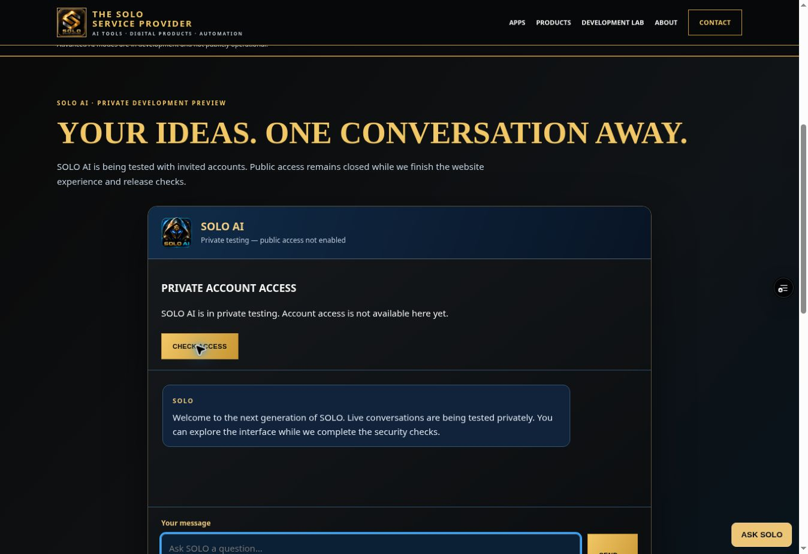

# SOLO browser account isolation — 27 October 2026

## Outcome

Implemented and regression-tested account binding for browser chat, then deployed
and checked the closed-access website in a real desktop browser. This cycle does
**not** establish signed-in browser, real cross-tab account-switching or Samsung
device acceptance. Public inference remains disabled.

Code: [`057ed6114206fa0b0ab2c2ed094596410f2bdb76`](https://github.com/joshuawayzwright/ai-download-center/commit/057ed6114206fa0b0ab2c2ed094596410f2bdb76).
Draft [PR #34](https://github.com/joshuawayzwright/ai-download-center/pull/34)
remains unmerged. [Issue #31](https://github.com/joshuawayzwright/ai-download-center/issues/31)
is the current release checklist.

## Defect and change

Cookies are shared between tabs on one host. An old tab could retain account A's
conversation after another tab logged in as account B. Its next request would
carry B's cookie while still containing A's history. This was reproduced with
the actual account/conversation controllers and simulated cookie/network state;
no real customer text was used.

Browser cookie chat now carries `expectedUserId` from verified account status.
After online authentication, the API compares it with the cookie's authenticated
UUID **before quota admission or provider dispatch**. Missing/malformed bindings
return 400 `expected_account_required`; mismatches return 409 `account_changed`.
This is a consistency check, never authorization. Explicit Bearer and owner-only
requests remain compatible without this field.

A missing access cookie with customer intent returns 401 `session_expired` when
the customer gate is open, allowing the existing refresh flow. A present invalid
or expired token returns 401 `invalid_session`. Closed gates take precedence.
The customer request cannot fall through to owner-token authorization.

The browser clears stale transcript/history/draft/retry state, ignores late
responses and rechecks account access. A fixed BroadcastChannel signal contains
no identity, messages or credentials. Focus, visibility and restored-page checks
provide additional revalidation. No inference request is automatically retried.
If notifications are missed or a status check fails, the display can remain
stale temporarily; the server binding still prevents submission under a different
account. Cancelling the browser request cannot undo a call already admitted.

Small website fixes accompany the isolation change: the hero button now targets
`#conversation`; a 100px scroll margin clears the fixed header; a skip link and
main landmark support keyboard navigation; the conversation log is focusable;
usage status is announced; private-preview wording matches the recorded state.
Approved image paths and artwork were preserved.

## Automated verification

[CI run 40497102111](https://github.com/joshuawayzwright/ai-download-center/actions/runs/40497102111)
passed at the code commit: **158 API/browser/smoke tests + 21 SQL tests = 179**,
zero failures or skips. The added 21 regressions cover binding rejection before
admission, compatibility, missing-cookie handling, stale replies, same-user
refresh, cross-tab invalidation and a combined account/chat-controller sequence.
The two actual browser controllers are exercised with **mocked transports** in
that combined test; it is not evidence of a live signed-in browser session.

[Repository quality run 40497102226](https://github.com/joshuawayzwright/ai-download-center/actions/runs/40497102226)
also passed. Local JavaScript and SQL commands exited successfully; CI provides
the authoritative individual test count. HTML structure checks found one
balanced main landmark, unique IDs and valid fragment targets. Approved image
paths match the previous commit; `git diff --check` passed.

## Deployment and actual HTTP checks

- Deployment: **`dpl_CrptDDmWkonFKZ27xibWehkdHqJo`**, READY.
- Source: **`057ed6114206fa0b0ab2c2ed094596410f2bdb76`**, confirmed in deployment metadata and build logs.
- [Protected SOLO preview](https://solo-provider-industrial-3j5n9hezq-wrightwayz.vercel.app/solo-ai.html#conversation).
- Normal Preview build, no diagnostic build override; customer gates stayed closed.

| Actual request | Observed result |
| --- | --- |
| GET `/api/solo-auth` | 200; enabled/authenticated/chatEnabled all false; `no-store, private` |
| POST `/api/solo-auth`, refresh action | 503 `auth_disabled` |
| POST `/api/solo-chat`, deliberately invalid Bearer | 503 `customer_disabled` |
| POST `/api/solo-chat`, expected account UUID without an access cookie | 503 `customer_disabled` |

All four assertions passed: `SOLO_CUSTOMER_CONFIG_DISABLED_PASS`. These are
closed-gate checks, not positive authentication or model-response checks.

## Actual desktop browser checks

Chrome viewport **1363 × 936** on the protected deployed page:

| Interaction/observation | Verified result |
| --- | --- |
| Activate EXPLORE SOLO AI | URL changes to `#conversation` |
| Measure settled anchor | Section top 100.0625px, fixed header bottom 77px; heading is visible below header |
| First keyboard Tab | Skip link receives focus and is visible at top 8px |
| Enter on skip link | Main landmark `solo-main` receives focus |
| Check Access, then Tab | Conversation log receives focus with visible solid outline |
| Next Tab | Message input receives focus |
| Closed account panel | Login form hidden; private-access message shown |
| Desktop document width | No horizontal overflow at the measured viewport |

Captured console errors were from the browser extension; no application-origin
error appeared in the inspected log sample. This is not exhaustive runtime-error
monitoring or screen-reader/contrast certification.

## State preserved

A read-only commercial SQL check at **2026-10-27 11:36:42.6792 UTC** returned:
policy disabled; user caps 3/minute and 20/day; global caps 20/minute and 200/day;
zero eligible members; zero sessions for the two existing fixture identities;
**15 retained ledger rows**, including the same **four prior Gemini successes**.
This cycle made no provider calls or hosted database writes.

The production alias still points to maintenance deployment
`dpl_9KijhLqwcEABqisC59RiLYJgyeV8`. No environment flag, credential, billing,
Stripe, branding asset, production release or WrightWayz resource was changed.

## Remaining acceptance

1. Real customer sign-in/chat through the website, then real two-tab account
   switching and session expiry on the deployed binding code.
2. Samsung mobile and complete desktop keyboard/focus/contrast/accessibility
   acceptance. The current browser surface supplied no device/viewport emulation.
3. Hosted provider-error/timeout and finalization-failure accounting; monetary
   ceilings, monitoring, abuse controls, privacy/retention and release approval.

The earlier [customer Gemini result](SOLO-CUSTOMER-GEMINI-VERIFICATION-2026-10-27.md)
and [hosted Auth/quota result](SOLO-CUSTOMER-LIVE-VERIFICATION-2026-10-27.md) remain
valid historical milestones. They were not repeated and do not prove the new
binding code in a live signed-in browser. No customer credential is retained in
the current workspace; real browser sign-in requires the supported secure
credential-entry path. Do not recreate accounts or infrastructure for that gate.

Machine-readable results: [sanitized evidence](evidence/solo-browser-isolation-2026-10-27.json).
