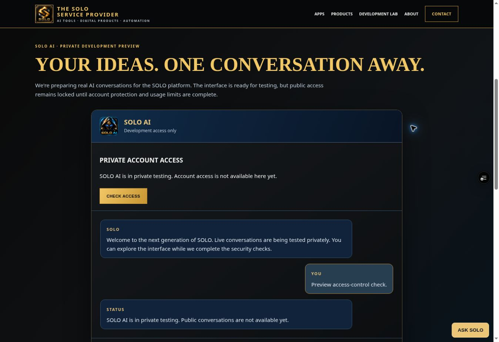

# SOLO customer access — 27 October 2026

## Release status

Customer login, secure session handling, durable request admission and the web
account panel are implemented for a Preview-only pilot. The existing commercial
Supabase project is now accessible and its admission migration has been applied
and checked on the hosted database. **Live customer login, concurrent hosted
quotas and customer-authenticated Gemini chat remain unverified.**

Two configuration blockers remain: the server-side Supabase secret key is not
configured in Vercel, and actual Auth settings show unrestricted signup is still
enabled. Both customer Preview flags and the hosted SQL policy remain disabled.
Production remains the existing maintenance deployment; public inference stays off.

The previous owner-token Gemini two-turn HTTP result remains recorded in
[the private API verification](SOLO-PRIVATE-CHAT-VERIFICATION-2026-10-27.md).
This work extends that same `/api/solo-chat`; it does not create another AI backend.

Current commits, preview deployment, test totals and remaining release gates are
recorded in [issue #31](https://github.com/joshuawayzwright/ai-download-center/issues/31).

## GitHub and deployed evidence

- Hosted setup and verification runner: [`29de409f6ec784b5e8a6e550bcd0d4ca8e1381b9`](https://github.com/joshuawayzwright/ai-download-center/commit/29de409f6ec784b5e8a6e550bcd0d4ca8e1381b9).
- Current CI: [run 40468034635](https://github.com/joshuawayzwright/ai-download-center/actions/runs/40468034635) passed **127 API/browser/smoke tests + 21 SQL tests = 148**, zero failures or skipped tests. [Repository quality run 40468034728](https://github.com/joshuawayzwright/ai-download-center/actions/runs/40468034728) also passed.
- Current normal protected Preview: `dpl_3iKhAVdexUXURiQ5YupThKu5aVco`, **READY** at `29de409f6ec784b5e8a6e550bcd0d4ca8e1381b9`: [SOLO preview](https://solo-provider-industrial-3weap1tym-wrightwayz.vercel.app/solo-ai.html#conversation). It consumes the five new Preview variables with both customer flags false. No build override was used.
- Three real HTTP checks against that new deployment passed: account GET **200** with all three enabled/authenticated/chat booleans false and private/no-store caching; account refresh POST **503 `auth_disabled`**; customer chat POST **503 `customer_disabled`**. Marker: `SOLO_CUSTOMER_CONFIG_DISABLED_PASS`. These checks made no Supabase Auth or Gemini calls and do not establish live customer login.

Earlier implementation and browser evidence:

- Implementation: [`430e50ad98058d17bf4cf3fb1505a52301d32535`](https://github.com/joshuawayzwright/ai-download-center/commit/430e50ad98058d17bf4cf3fb1505a52301d32535), [draft PR #34](https://github.com/joshuawayzwright/ai-download-center/pull/34).
- CI: [SOLO API and database run 40449786312](https://github.com/joshuawayzwright/ai-download-center/actions/runs/40449786312) passed: 118 API/browser/smoke tests and 21 SQL tests, zero failures. [Repository quality run 40449786100](https://github.com/joshuawayzwright/ai-download-center/actions/runs/40449786100) also passed.
- Normal Vercel preview: `dpl_bgKY3WhfdNKAq9Yg1LVi9vHuYoKi`, READY, exact implementation SHA above. [SOLO preview](https://solo-provider-industrial-f8ujxpeox-wrightwayz.vercel.app/solo-ai.html#conversation) requires authorised Vercel access.
- Production homepage was rechecked and returned the existing maintenance page, HTTP 200. It was not promoted or changed.

At 04:29 UTC, six real HTTP checks against that protected deployment passed:

| Check | Actual result |
| --- | --- |
| Account status GET | 200, `enabled:false`, `authenticated:false`, `chatEnabled:false`, `no-store, private` |
| Account POST refresh while disabled | 503, `auth_disabled` |
| Chat GET | 405 |
| Chat POST without owner/customer credentials | 401 |
| Chat POST with a dummy customer Bearer credential while disabled | 503, `customer_disabled` |
| Account POST from another Origin | 403, `invalid_origin` |

The checks logged `SOLO_CUSTOMER_DISABLED_GATES_PASS`. They did not call Gemini,
Supabase Auth or any customer database. They prove that the deployed gates and
function bundle work; they do not prove live customer authentication.

In the actual desktop browser, the account panel showed that access was
unavailable, its login form stayed hidden, and a submitted chat request showed
the private-testing notice and restored the draft. No model reply was invented.
This verifies the closed-gate browser interaction, not active login or Samsung
device acceptance. The existing artwork was retained.



## Implemented behavior

- Same-origin `/api/solo-auth` login, status, refresh and logout, with no public signup action.
- Host-only Secure/HttpOnly/SameSite=Strict access and refresh cookies. Browser code and JSON responses contain no credentials.
- Online validation of the exact customer access JWT, followed by live session and membership checks in SQL. Customer credentials never fall back to the owner token.
- One existing chat route for browser cookies and future Android Bearer sessions. The Android client itself remains unfinished.
- Durable SQL admission before inference, with per-user and global minute/day allowances. A transaction locks and versions the policy row; no lock is held during Gemini inference.
- Request UUID and HMAC fingerprint prevent duplicate provider dispatch. Every reservation counts, including failed or unfinished calls; no automatic inference retry or refund.
- Provider outcome and safe token observations are recorded. A finalization failure returns an error, not a claimed successful conversation.
- A minimal account panel uses existing SOLO styling and artwork. Login status, usage, session expiry, rate-limit wait and already-accepted requests have explicit UI states. Account changes clear retained chat context.

The initial SQL policy is **disabled**, no members are created, and membership
defaults to blocked. Test caps are three requests/user/minute, 20/user/day,
20/global/minute and 200/global/day. These are bounded pilot defaults, not
approved paid subscription entitlements or a monetary spending budget.

## Database isolation and permissions

`solo_private` contains policy, membership and a request ledger. Client roles
cannot use the schema, read its tables or execute the three RPCs. RLS is enabled
and forced. The RPCs are `SECURITY INVOKER` with an empty search path and explicit
server-role execution grants.

The runtime may read policy/membership, reserve requests and finalize outcomes.
The new grants do not permit it to enable the policy, alter caps, enrol members,
delete reservations or write Supabase Auth data. Hosted inspection confirmed
these boundaries and exactly three readable `auth.sessions` columns: `id`,
`user_id` and `not_after`. No new Auth tables are created by the migration.

The ledger stores user/session/request identifiers, HMAC fingerprints, timestamps,
outcomes, model and token observations. It stores no prompt/reply text, email,
IP address, password or API key. Session/account deletion does not erase global
usage or reset its allowance. A reviewed retention/deletion process and
provider-side privacy disclosure remain release requirements.

## Hosted commercial database verification

The existing project `tymayhazawkofmiypeqt` is `ACTIVE_HEALTHY` in **The Solo
Service Provider** organisation `txfdoppxcbylrguxsjod`, on the **Free** plan in
its existing `ap-northeast-1` region. Reuse this project and region. WrightWayz
resources, credentials, data and billing were not used.

The hosted migration is version **`20261027071534`**, name
`solo_customer_admission`. The matching source is
[`supabase/migrations/20261027071534_solo_customer_admission.sql`](../supabase/migrations/20261027071534_solo_customer_admission.sql).
The local file was renamed to match the applied version without changing its SQL.
The sanitized [hosted database evidence](evidence/solo-commercial-database-2026-10-27.json)
records the observed grants, disabled-state calls and HTTP boundaries.

Live database inspection verified:

- All three `solo_private` tables have RLS enabled and forced.
- The checked functions use `SECURITY INVOKER` and an empty search path.
- `PUBLIC`, `anon` and `authenticated` lack the private schema/table/RPC permissions.
- Runtime grants do not allow changing policy settings, enrolling members,
  deleting ledger rows or writing Auth data; the session read grant is limited
  to the three columns listed above.
- Service-role calls inside rolled-back SQL transactions returned the expected
  disabled status, disabled admission, `invalid_request` for an invalid
  fingerprint, and `request_not_found` for an unknown finalization target.
- The final state is **policy disabled, zero members, zero ledger rows**.

Actual HTTPS requests using the commercial publishable key also verified all
three SOLO RPCs reject anonymous calls with **HTTP 401 / SQL code `42501`**,
and requests selecting the private schema return **HTTP 406 / `PGRST106`**.
The check logged `SOLO_COMMERCIAL_ANON_BOUNDARY_PASS`; no key was logged.

Advisor results contain no warning/error findings. The five informational
findings are three RLS-without-policy notices, expected for these service-only
tables, and two unused indexes on the empty ledger. These results verify the
inspected grants and disabled boundaries, not a successful customer session or
simultaneous hosted admission.

An actual Auth settings GET returned HTTP 200 with `disable_signup=false`,
email authentication enabled, anonymous users disabled, and email
auto-confirmation disabled. **Unrestricted signup must be disabled before the
pilot.** The application itself has no signup action, but that does not close
Supabase's own signup endpoint.

## Automated verification

The current CI run `40468034635` verifies **148 passing tests**: 127
API/browser/smoke tests and 21 SQL tests, with zero failures or skipped tests.
This includes the previous 139-test baseline plus nine tests for the opt-in
hosted verification runner. Those nine tests use mocked services; they do not
prove a hosted customer session.

| Suite | Passing tests |
| --- | ---: |
| Existing chat API regressions | 31 |
| Customer access and quota adapter | 25 |
| Login, refresh, status and logout API | 20 |
| Account browser controller | 17 |
| Conversation browser controller | 21 |
| Existing opt-in owner smoke runner | 4 |
| New opt-in hosted verification runner | 9 |
| Actual SQL migration in PGlite | 21 |

The new runner and its prerequisites are documented in
[hosted customer verification](SOLO-HOSTED-CUSTOMER-VERIFICATION.md). Its mocked
tests exercise the harness, not real account creation, login or inference.

API and browser-controller tests use dummy credentials and simulated service
responses. They cover session/cookie/Origin boundaries, production disablement,
bad credentials, membership denial, DB/Auth outages, quota/duplicate mapping,
provider-failure accounting, finalization failure and preservation of the owner
testing path. Account tests cover secure cookie behavior, rotation, logout,
expiry, error handling and client state. Existing regression tests remain included.

SQL tests execute the actual generated migration using pinned PGlite 0.5.12
(PostgreSQL 18.6). Tests cover limits, duplicate IDs, session revocation and
ownership, member expiry/blocking, permissions, no refunds, immutable completion,
storage failure and usage persistence after account deletion.

PGlite has one connection. Queued simultaneous JavaScript calls prove the tested
SQL outcomes, but **do not prove overlapping independent hosted PostgreSQL
transactions**. The hosted schema/grants and disabled SQL boundaries are now
checked separately as recorded above. Live session rotation, active admission
and independent concurrent transactions remain to be verified. See
[SQL test instructions](../tests/solo-database/README.md).

```sh
node --test powerhouse-website/tests/*.test.cjs
cd tests/solo-database
npm ci --ignore-scripts
npm test
```

The Node 24 local sandbox may summarize each isolated test file as one test.
Run an individual `.test.cjs` directly to see its assertion count. CI uses Node 22.
No test automatically calls Gemini or requires a real customer/provider secret.

## Remaining commercial configuration

The commercial connection now reaches the existing project above. Project
creation and organisation authorization are no longer blockers. The current
connector does not expose retrieval of the modern server secret key or mutation
of Auth signup settings. Complete those two existing-project settings securely
before enabling account access; do not request another Gemini key or repeat
OpenAI/Groq setup.

Vercel **Preview** configuration now contains five newly created sensitive
variables. The current deployment `dpl_3iKhAVdexUXURiQ5YupThKu5aVco` was created
after these settings and its disabled customer gates passed live HTTP checks.
A further deployment is needed after the remaining server key and controlled
pilot settings are configured.

| Variable | Current state and purpose |
| --- | --- |
| `SOLO_CUSTOMER_AUTH_ENABLED` | Configured sensitive for Preview; **false** |
| `SOLO_CUSTOMER_CHAT_ENABLED` | Configured sensitive for Preview; **false** |
| `SOLO_SUPABASE_URL` | Configured for the existing commercial project |
| `SOLO_SUPABASE_PUBLISHABLE_KEY` | Configured sensitive; modern key for server Auth exchange |
| `SOLO_SUPABASE_SECRET_KEY` | **Absent; blocker.** Modern server key is required for RPC access via `apikey` |
| `SOLO_USAGE_HASH_SECRET` | Configured sensitive; independently generated from 48 random bytes |

Keep the existing Gemini Preview configuration and private owner token. Never
copy charity keys or grant its resources to SOLO. Do not expose the server key
or owner token to the website, Android, source control, logs or issue comments.

Before enabling the pilot, verify `disable_signup=true` in actual Auth settings,
configure the missing sensitive Preview server key, and create controlled test
identities without unsolicited emails. Explicitly enrol expiring members. The
account endpoint requires an active SQL policy/member even for login, so enable
that policy only for a bounded verification window; the customer chat flag can
remain off during auth-only checks. Validate login, refresh, logout and stale-JWT
rejection against the real service, then exercise overlapping HTTP requests,
duplicate IDs, exhausted user/global allowances and outages. Verify a complete
customer-authenticated Gemini conversation and accurate ledger outcomes.

## Remaining release gates

- [x] Existing separate commercial project accessed and its schema/security advisors inspected.
- [x] Migration `20261027071534` applied; hosted grants/RLS and disabled service-role RPC outcomes verified.
- [x] Anonymous HTTPS calls to all three RPCs/private schema rejected with expected permission errors.
- [x] Five sensitive Preview variables configured; both customer flags remain false.
- [ ] Configure `SOLO_SUPABASE_SECRET_KEY` securely for Preview.
- [ ] Disable unrestricted Supabase signup and re-read actual Auth settings.
- [ ] Create controlled test identities and expiring memberships; redeploy and verify the bounded pilot.
- [ ] Live customer login, cookie rotation and logout/revoked-session rejection verified.
- [ ] Independent concurrent requests demonstrate strict caps and duplicate suppression.
- [ ] Customer-authenticated Gemini conversation and error accounting verified end to end.
- [ ] Desktop and Samsung browser behavior, keyboard, focus and accessible account/chat states verified.
- [ ] Approved customer retention/deletion disclosure, monetary controls and public abuse controls.
- [ ] Explicit production release approval and actual deployed production verification.

A passing test suite or READY deployment does not close those gates.
